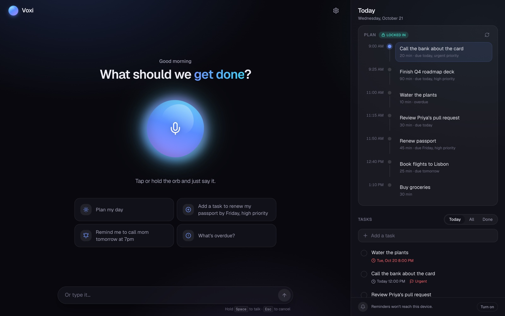
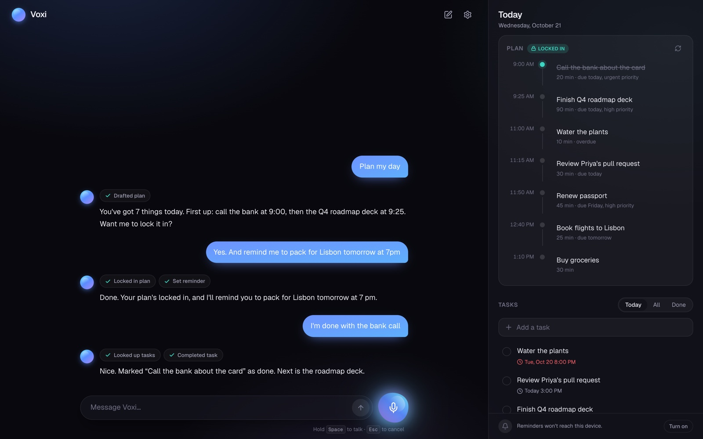
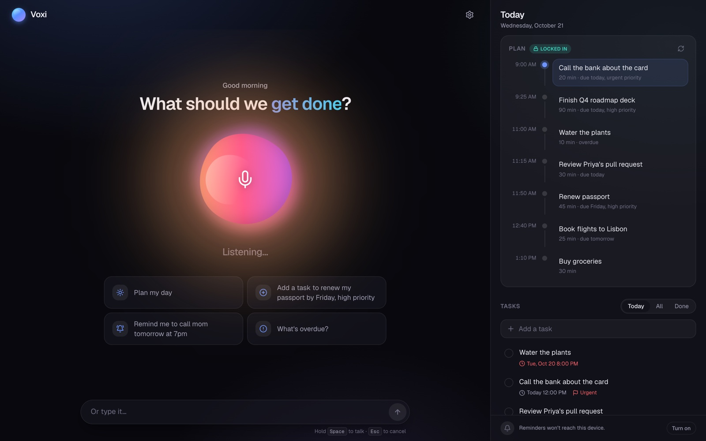
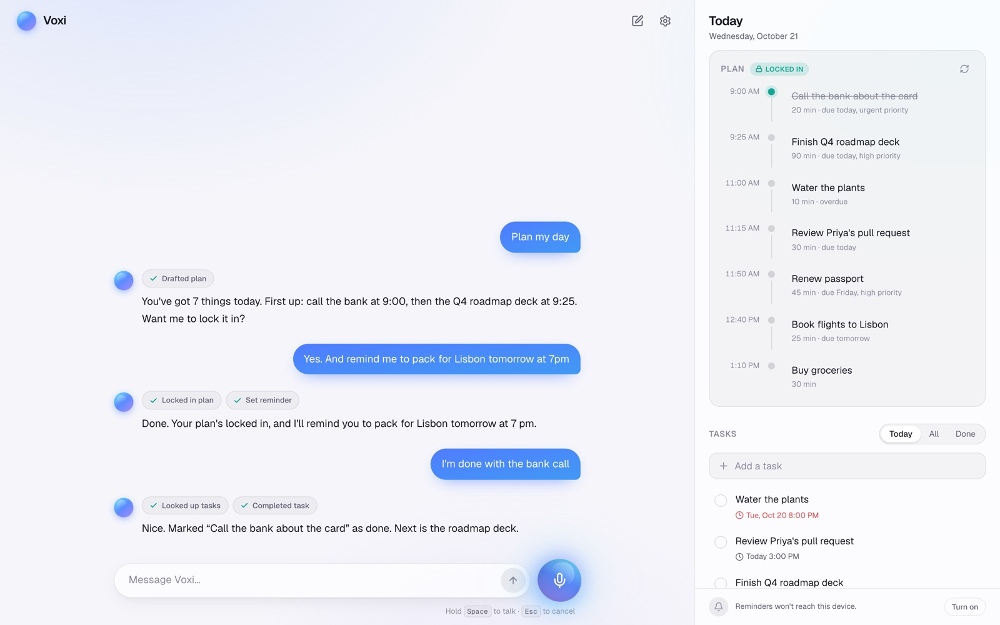
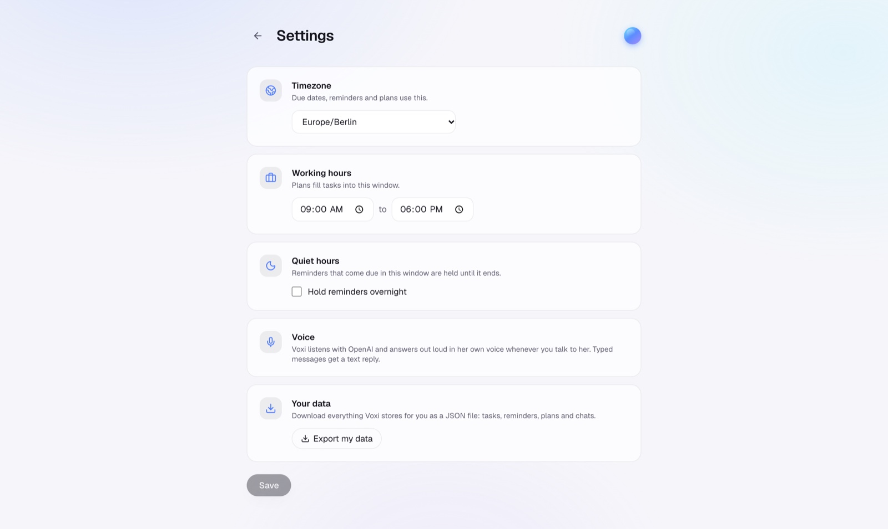
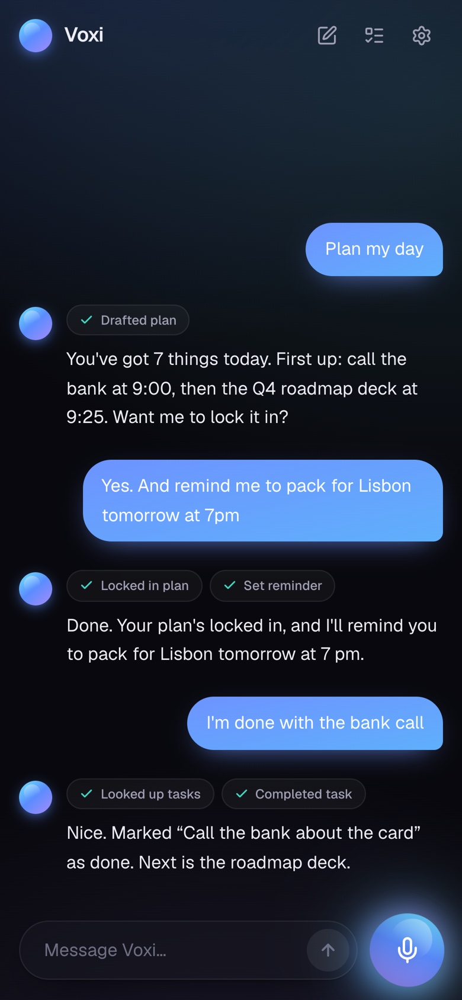
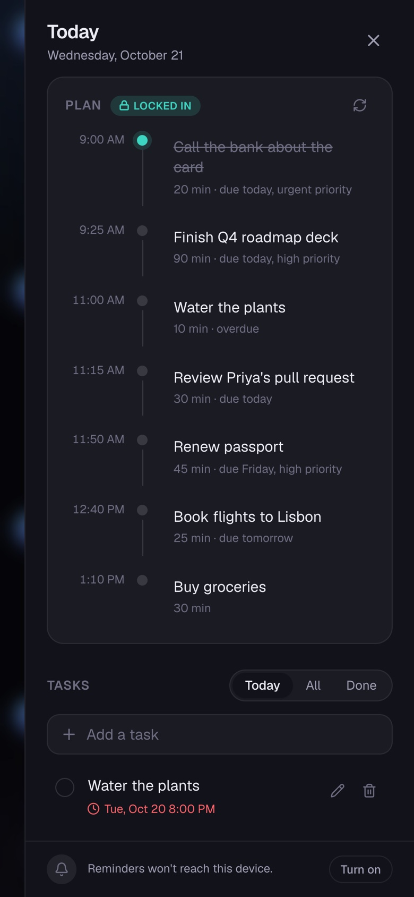
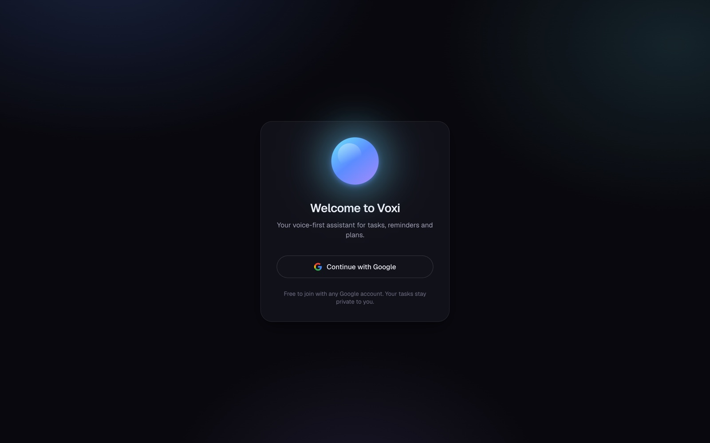

# Voxi

A voice-first assistant for your tasks, reminders and day plans. Tap the orb and just say it — "add a task to renew
my passport by Friday", "remind me to call mom at 7", "plan my day", "I'm done with the report" — and Voxi does it,
answers out loud, and reminds you on time with push notifications. You can type too.



## Screenshots

| Talking to Voxi | Listening |
| :---: | :---: |
|  |  |
| **Light mode** | **Settings** |
|  |  |

<p align="center">
  
  &nbsp;&nbsp;
  
</p>

<p align="center">
  
</p>

## Local setup

Needs Node 22+ and a Neon project (create a `dev` branch for local work).

```bash
cp .env.example .env        # fill in Neon URLs and the other keys
npm install                 # also runs prisma generate
npm run db:migrate          # applies prisma/migrations to the Neon branch in DIRECT_URL
npm run dev                 # http://localhost:3000
```

`npm test` creates and deletes throwaway users in whatever database `DATABASE_URL` points at, so point it at the Neon `dev` branch, not production.

## Voice

Hold the orb (or Space) to talk and release to send, or tap to start and tap again to send; Esc cancels. Talking
while Voxi speaks interrupts it. Speech is always OpenAI: the recording goes to `/api/transcribe`
(`OPENAI_TRANSCRIBE_MODEL`) and replies to voice turns are spoken via `/api/speech` (`OPENAI_TTS_MODEL`) in a female
voice: `nova` by default, or `shimmer` / `coral` via `OPENAI_TTS_VOICE`. Typed turns get text only.
On iOS the tap that starts listening also unlocks audio, so the spoken reply can play when it arrives.

The mic needs HTTPS or localhost.

## Settings and your data

`/settings` (or just tell Voxi: "my working hours are 8 to 5", "quiet hours 10pm to 7am", "I moved to New York"):
timezone, working hours (what plans fill), and quiet hours. A reminder due during quiet hours is held until they end;
a repeating one keeps its schedule and that occurrence is delivered when quiet hours end. Changing timezone keeps
daily briefings at the same local time. `OWNER_TIMEZONE` only seeds a new account.

The conversation is saved, so "that task" still works after a reload; "New chat" starts fresh. "Export my data" on
the settings page downloads everything as JSON (tasks, reminders, plans, chats), which is your backup beyond Neon's
short restore window.

## Reminders

Each active reminder has one Trigger.dev delayed run, created/cancelled/rescheduled whenever the reminder changes
(including snooze and undo). The run sends a web push to every device that turned notifications on, then marks the
reminder fired or re-arms it for its next recurrence. An hourly `sweep-reminders` cron delivers anything that slipped
through (labelled "Missed reminder"); it's hourly because the Trigger.dev free plan allows at most one cron run per hour.

Locally, reminders only fire while the worker runs:

```bash
npm run trigger:dev
```

Turn notifications on from the bar under the chat. On iPhone, add Voxi to the Home Screen first (iOS only allows web
push for installed web apps), and Done/Snooze buttons aren't shown there.

## Scripts

| Script | What it does |
|---|---|
| `npm run dev` | Next.js dev server |
| `npm test` | Vitest (repo tests hit the database in `DATABASE_URL`) |
| `npm run eval` | Agent evals: real OpenAI calls with a fixed clock, checks the resulting DB state (~1 min, a few cents) |
| `npm run typecheck` | Generates route types, then `tsc --noEmit` |
| `npm run lint` | ESLint |
| `npm run trigger:dev` | Trigger.dev worker for local reminder delivery |
| `npm run trigger:deploy` | Deploy tasks to Trigger.dev prod |
| `npm run db:migrate` | Create/apply a migration in dev (`prisma migrate dev`) |
| `npm run db:deploy` | Apply migrations in prod (`prisma migrate deploy`) |

## Layout

```
prisma/schema.prisma      data model (users, tasks, reminders, action_log)
src/lib/db.ts             Prisma client; Neon adapter for *.neon.tech, pg adapter otherwise
src/lib/owner.ts          single-owner "auth" until Google sign-in lands
src/lib/tasks/            zod schemas + repository (create/update/delete/complete/find)
src/lib/reminders/        zod schemas + repository (create/list/update/cancel/snooze)
src/app/api/              REST route handlers
src/lib/undo.ts           undo via action_log snapshots
src/lib/time.ts           timezone helpers (local wall clock ↔ UTC, DST-aware)
src/lib/planning/         planner.ts (scoring + fitting), repo.ts (propose/accept), briefing.ts
src/app/plan-card.tsx     today's plan card
src/lib/chat.ts           persisted conversation (one current chat; "New chat" starts another)
src/lib/settings.ts       timezone, working hours, quiet hours
src/lib/export.ts         JSON export of all user data
src/app/settings/         settings page
src/lib/agent/            OpenAI agent: tools, instructions, local-time helpers
src/app/api/chat/         streaming chat endpoint (AI SDK)
src/app/assistant.tsx     chat panel, mic button, voice settings
src/app/use-voice.ts      push-to-talk (browser or OpenAI STT), speech output, barge-in
src/lib/speech.ts         OpenAI transcription + TTS
src/lib/push.ts           web push sending + subscriptions
src/lib/reminders/        scheduler.ts (Trigger.dev runs), fire.ts (delivery logic)
src/jobs/reminders.ts     Trigger.dev tasks: fire-reminder, sweep-reminders
public/sw.js              service worker: notifications, Done / Snooze
src/app/task-board.tsx    task UI
evals/                    agent evals
```

## API

| Method | Path | Body / query |
|---|---|---|
| GET | `/api/tasks` | `query, status, project, tag, dueBefore, dueAfter, overdue, includeDone, limit` |
| POST | `/api/tasks` | `{ title, notes?, priority?, dueAt?, estimateMin?, project?, tags?, recurrenceRule? }` |
| GET / PATCH / DELETE | `/api/tasks/:id` | PATCH takes any task field plus `status` |
| POST | `/api/tasks/:id/complete` | recurring tasks spawn the next instance |
| GET | `/api/reminders` | `from, to, status, limit` |
| POST | `/api/reminders` | `{ message, fireAt, recurrenceRule?, taskId?, channels? }` |
| PATCH / DELETE | `/api/reminders/:id` | DELETE cancels |
| POST | `/api/reminders/:id/snooze` | `{ minutes }` (default 10) |
| GET | `/api/chat` | current conversation `{ id, messages }` |
| POST | `/api/chat` | `{ id, message }` (only the new message); streams the reply, saves the chat |
| POST | `/api/chat/new` | starts a new conversation |
| GET / PATCH | `/api/settings` | `{ timezone, workStart, workEnd, quietStart, quietEnd }` (times `HH:MM`) |
| GET | `/api/export` | downloads all your data as JSON |
| POST | `/api/transcribe` | multipart `audio` file → `{ text }` |
| POST | `/api/speech` | `{ text }` → mp3 audio |
| POST | `/api/reminders/:id/done` | notification "Done": completes the linked task |
| POST / DELETE | `/api/push/subscribe` | browser `PushSubscription` JSON / `{ endpoint }` |
| GET | `/api/plans?day=` | today's plan (accepted, else latest draft) |
| POST | `/api/plans` | `{ day?, days? }` drafts a plan |
| POST | `/api/plans/:id/accept` | `{ remindAtBlockStart? }` locks it in |

## Sign-in

Google sign-in via Auth.js (`src/auth.ts`). **Anyone with a verified Google account can join**, and each account
gets its own private Voxi: every query is scoped to the signed-in user (`src/lib/owner.ts` maps the session email to
a user row, created on first sign-in with the visitor's timezone from Vercel's `x-vercel-ip-timezone` header).
Set `AUTH_ALLOWED_EMAILS` to restrict sign-in to a list. Sessions are signed JWT cookies (30 days). `src/proxy.ts`
sends signed-out page visits to `/signin` and answers signed-out API calls with 401.

Because it's open, every user's chat, speech and transcription runs on your OpenAI key: set a monthly usage limit
in the OpenAI dashboard. In Google Cloud, publish the OAuth consent screen (in "Testing" only listed test users can
sign in).

For automated local testing without Google, `AUTH_DEV_BYPASS=true` acts as `OWNER_EMAIL`; it's ignored in production.

## Deploying (Vercel + Neon + Trigger.dev)

1. **Google Cloud → Credentials → your OAuth client:** add `https://YOUR-DOMAIN/api/auth/callback/google` as an
   authorized redirect URI (keep the localhost one for dev). For open sign-up, set the OAuth consent screen to
   **In production** (Publish app); in "Testing" only listed test users can sign in.
2. **Neon:** apply migrations to the production branch once: `npm run db:deploy` with `DIRECT_URL` pointing at it.
3. **Vercel → Project → Settings → Environment Variables (Production):**
   `DATABASE_URL` (pooled), `DIRECT_URL`, `OPENAI_API_KEY` (+ optional `OPENAI_*` model vars), `AUTH_SECRET`,
   `AUTH_GOOGLE_ID`, `AUTH_GOOGLE_SECRET`, `OWNER_EMAIL`, `OWNER_TIMEZONE`, `VAPID_PUBLIC_KEY`,
   `NEXT_PUBLIC_VAPID_PUBLIC_KEY`, `VAPID_PRIVATE_KEY`, `VAPID_SUBJECT`, and the **prod** `TRIGGER_SECRET_KEY`
   (`tr_prod_…`). Don't set `AUTH_DEV_BYPASS`. Vercel sets the trusted host for Auth.js automatically.
4. **Trigger.dev dashboard → Environment variables → Prod:** `DATABASE_URL`, `OPENAI_API_KEY` and `OPENAI_MODEL`
   (the morning briefing drafts a plan), `TRIGGER_SECRET_KEY` (prod), and the four VAPID vars. Then
   `npm run trigger:deploy`.
5. **Deploy** (push to the connected GitHub repo, or `vercel --prod`), open the site, sign in, turn on notifications.
